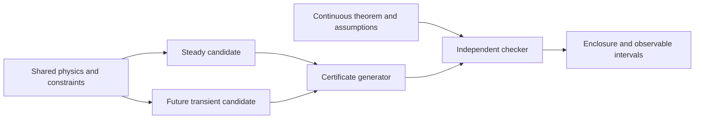

# kin6d design

Status: proposed design, 2026-10-05. Audience: plasma physicists, numerical
analysts, and implementers in the itpplasma group.

## Scientific objective

The first runnable configuration is the
[steady 1X1V student laboratory](docs/student-laboratory.md). Tiny transient
and HM turbulence examples accompany the direct steady spine rather than
driving architecture. The first scientific application after collision and
classical-transport laboratories is real-device DK neoclassical transport.

kin6d will solve stationary, deterministic, full-distribution kinetic
problems for electrons and several ion species in general physical geometry.
Cartesian space and vectors are fundamental; cylindrical/Fourier is the
initial optimized fusion chart, not a requirement of the physics. The
long-term full-kinetic reference is relativistic Vlasov–Maxwell with nonlinear
Beliaev–Budker collisions. Nonrelativistic Landau problems provide a baseline
and independent limiting cases. More detailed correlation models are later
research capabilities.

The code family also targets reduced and hybrid production models for useful
whole-device questions. Species models are selected independently, subject
to derived field and collision compatibility: FK, GK, DK, parallel kinetic,
bounce/orbit averaged, gyrofluid/Landau-fluid/gyromoments, ordinary fluid,
adiabatic, or fixed. Implement each only
when a scientific case needs it. All-FK remains the reference; global
turbulence need not pay its cost. [Species models](docs/species-models.md)
defines reductions, closures, and the early fixed-ion electron configuration.

The physical mission spans shaped and high-field tokamaks, heliotrons, and
QA/QI stellarators, from present experiments to named reactor designs.
Geometry exposes generic 3D fields and domains; symmetry is an optimization
with checked assumptions. [Device envelope](docs/devices.md) defines the
machine missions and physical-parameter production gates.

The distinguishing output is a certified enclosure of an exact solution of
the specified continuous boundary-value problem, together with intervals for
requested observables. A nonlinear solver supplies an approximation. A
separate certifier supplies the mathematical argument. Lean checks the
certificate theorem and its numerical premises as those proofs become
available. An uncertified candidate cannot be promoted to an accepted result.

This is a statement about numerical error within a model. Classical kinetic
closures omit correlations and may omit atomic, quantum, radiative, or
large-angle processes. A stationary solution need not describe a dynamically
unstable or evolving discharge. These distinctions are part of the model
metadata, rather than additional digits in a numerical enclosure.

## Decisions

The [model-family philosophy](docs/model-family.md) adds bulk MHD and
kinetic–MHD configurations without introducing separate named-code modes.
Population ownership, closures and field equations must be consistent.
Imported equilibria are untrusted inputs/candidates; equilibrium, forced
response, spectral stability and evolution each have their own certificate.
Use the cheapest supported model that meets the stated scientific/error goal.

| Subject | Decision |
|---|---|
| Application and certifier | Fortran; no mandatory Python layer |
| Numerical kernels | Mandatory fortsym emission with retained generators and provenance |
| State | Deterministic active species blocks; relativistic physical momentum for the FK reference |
| Species models | Per-species choice, with explicit supported field/pair combinations |
| Bulk model | None or a derived multi-fluid/MHD aggregate, with explicit population ownership |
| Geometry | Cartesian physical vectors with mapped elements; initial cylindrical DG/Fourier optimization |
| FK angular basis | Full spherical harmonics through degree `L_s`; no initial truncation in `m` |
| Radial momentum | Separate grid or mapping for each species |
| Spatial foundation | FortFEM generic spaces/maps/operators; plasma laws remain application-owned |
| Production performance | Tensorized actions, batched RHS, no full kinetic operator/Jacobian assembly |
| Physical geometry | Generic 3D field/domain evaluations; machine formats are adapters |
| Transport | One characteristic-based discretization, with certified reconstruction defects |
| Fields | Explicit prescribed/Poisson/quasineutral/Darwin/Maxwell choice; background, drive and response separated |
| Physics interface | Shared residual/brackets and constraints; direct steady consumer first, early student dynamics |
| Nonlinear solve | Direct residual solve through PETSc SNES/KSP |
| Reference collisions | Nonlinear Beliaev–Budker, after a certified Landau baseline |
| Collision comparisons | Cheap-to-Coulomb ladder; shared test/field/linear/nonlinear pair primitive |
| Discrete structure | Separate conservation/entropy treatment with its own verified properties |
| Nonlinear Fourier products | Padded physical-angle evaluation and projection |
| Certification | Independent continuous-problem bound; fail explicitly when unavailable |
| Formal verification | Small theorem/checker layer in Lean, developed with the first model |

The tiny laboratory is the first configuration of the engine; production
does not inherit its array layout. Geometry contracts permit general 3D
without requiring the first executable to allocate six-dimensional state.
General periodic zero modes are not automatically axisymmetric reductions.

## Hamiltonian, metric and open-system structure

Every model changes state space, derived reduction/closure or physical brackets
within the common numerical framework. Where established, reversible dynamics
has a Poisson operator and energy; dissipation has a symmetric nonnegative
metric operator and entropy/dissipative potential; sources, drive, radiation
and boundaries supply declared open-system transfers. The
[moment/structure policy](docs/moment-models.md) specifies bracket/Jacobi and
metriplectic degeneracy obligations. Antisymmetry or positivity alone does
not establish every conservation/entropy theorem, and not every reaction/wall
process follows from a conventional action principle.

The residual is the authoritative stationary equation, with dynamics using
the same vector field and constraints. FortFEM owns compatible spatial spaces,
FortSym owns local primal/JVP/VJP algebra, and execution plans own tiling and
scheduling. Characteristic transport, Galerkin residual and preconditioner
actions realize the same stated mathematical operator with explicit numerical
defects. Poisson brackets and residual Jacobians have distinct names/contracts.
[Adjoint structure](docs/adjoints-structure.md) records natural pairings,
nullspaces, positivity/inf-sup evidence, reciprocity and goal-error bounds.

## Additional directions and admission

[Edge physics](docs/edge-physics.md), [Solar System scope](docs/space-plasmas.md)
and [further extensions](docs/extensions.md) reserve reactions, heating/waves,
fusion products, neutrals, surfaces, field reductions, circuits and synthetic
diagnostics as independent mathematical actions where compatible. They are
long-range goals. Implement only the next needed seam, with an independent
oracle, coupling derivation and certification/performance target. Different
thin consumers may share libraries; there is no named-code solver registry.
SI definitions, explicit normalization and complete model/data/proof provenance
are part of each result. Statistical confidence and deterministic enclosures
remain distinct; combined model-error budgets need a proved comparison chain.

## Mathematical problem

For the all-FK reference, let `f_s(x,p)` be number density with respect to the
laboratory-frame measure
`d³x d³p`. Here bold momentum denotes the vector and `p=|p|` its magnitude.
Define

$$
\gamma_s(p)=\sqrt{1+p^2/(m_s^2c^2)},\qquad
\mathbf v_s(\mathbf p)=\mathbf p/(m_s\gamma_s).
$$

The stationary kinetic residual is

$$
F_s(U)=\mathbf v_s\cdot\nabla_x f_s
+q_s(\mathbf E+\mathbf v_s\times\mathbf B)\cdot\nabla_p f_s
-\sum_{s'}C_{ss'}[f_s,f_{s'}]-S_s(U)=0.
$$

Boundary conditions, gauges, prescribed densities or fluxes, and global
constraints complete this equation. Each case must specify them before
solving: the differential expression alone does not define a problem.
Stationary sources, inflow, wall loss, and imposed power must admit compatible
particle, charge, momentum, and energy balances.

Charge and current use the same physical momentum measure:

$$
\rho=\sum_s q_s\int f_s\,d^3p+\rho_{\rm prescribed},\qquad
\mathbf j=\sum_s q_s\int\mathbf v_s f_s\,d^3p
+\mathbf j_{\rm prescribed}.
$$

For time-independent fields, Maxwell's equations require

$$
\nabla\cdot\mathbf E=\rho/\epsilon_0,\quad
\nabla\times\mathbf E=0,\quad
\nabla\times\mathbf B=\mu_0\mathbf j,\quad
\nabla\cdot\mathbf B=0.
$$

The magnetic domain, exterior coupling, coil currents, conductor conditions,
and gauges must make this a well-posed field problem. Toroidal topology can
admit a curl-free electric field with nonzero loop voltage; a globally
single-valued electrostatic potential alone does not represent that drive.
A case with loop voltage must state its topological component and compatibility
with the stationary magnetic assumption.

Use `B = B0 + delta_B_ext + delta_B_induced`, and the analogous electric
split. A frozen bulk equilibrium can have a self-consistent induced response;
active/test/reservoir roles are independent of species representation.
[Coupling](docs/coupling.md) defines these choices and source ownership.
The simpler `B_vac + B_plasma` split remains a compatible full-state case.
Precompute fixed external fields and their chart coefficients. Certification still includes field interpolation,
geometry, and coefficient-tail bounds. Experimental field uncertainty is a
separate input enclosure or remains outside the theorem's scope.

Reduced species have their own unknowns, measures, Hamiltonians, moments,
and field-action terms, including polarization/magnetization where required.
They do not use the FK moments blindly. Fixed charge/current reservoirs
contribute without evolved state; fixed collision backgrounds additionally
specify their distributions. Fields can remain self-consistent when ions are
fixed. A compatibility table rejects unsupported model combinations.

## Spatial and momentum representation

The physical distribution is `f_s(x,p)` with independent spatial chart and
momentum frame. [Geometry](docs/geometry.md) defines mapped Cartesian,
cylindrical, spherical, curve-following and future unstructured choices.
Core physics cannot require a global toroidal angle or nested flux surfaces.
FCI is an optional parallel-operator service. A Figure-8 geometry test must
exercise this independence before generic-geometry promotion.

For the initial cylindrical fusion chart, the distribution is reconstructed from

$$
f_s(R,Z,\varphi,p,\Omega_p)=
\sum_{n\in\mathcal N}\sum_{\ell=0}^{L_s}\sum_{m=-\ell}^{\ell}
f^s_{n\ell m}(R,Z,p)e^{in\varphi}Y_{\ell m}(\Omega_p).
$$

Use real orthonormal spherical harmonics in a stated ordering, with complex
toroidal coefficients. Reality requires `f_{-n,lm}=conj(f_{n,lm})`. Independent
storage can retain nonnegative toroidal modes; transforms reconstruct the
negative modes. Fourier normalization and radial quadrature weights are
part of the representation contract.

### Cylindrical momentum frame

There is a necessary coordinate correction to the fixed-frame proposal.
Axisymmetry rotates position and momentum together. With a globally fixed
Cartesian momentum frame, an axisymmetric distribution can have explicit
toroidal dependence at fixed Cartesian momentum. Simply setting `n=0` would
exclude legitimate axisymmetric flows.

Use the orthonormal cylindrical frame `(e_R,e_phi,e_Z)` for momentum
components. Its rotation is prescribed by coordinates and is independent of
the magnetic field. Axisymmetry then is exactly `n=0`. Retain the geometric
connection terms from the first production residual:

$$
\dot R=v_R,\quad \dot Z=v_Z,\quad \dot\varphi=v_\varphi/R,
$$
$$
\dot p_R=q_s(E+v\times B)_R+p_\varphi\dot\varphi,\quad
\dot p_\varphi=q_s(E+v\times B)_\varphi-p_R\dot\varphi,\quad
\dot p_Z=q_s(E+v\times B)_Z.
$$

These terms preserve Cartesian free flight expressed in cylindrical
coordinates. The configuration measure is `R dR dZ dphi`, with `R>0` on the
initial toroidal domain. The geometry factors and momentum-frame rotation
must agree in transport, moments, reconstruction, and certification.
This derivation is a project obligation; an analytic Cartesian free-flight
case is its independent validator.

The Lorentz magnetic term rotates momentum and acts within each harmonic
degree through angular-momentum matrices. The coordinate rotation is another
known angular action. Electric acceleration and spatial streaming couple
angular degrees. Keep every `m` initially; a local magnetic-field frame with
`|m| << L` requires additional connection terms and a proved truncation bound.

### Radial momentum

Each species has its own physical momentum scale and resolution. Radial
operators, cross-species potentials, and moment quadratures must account for
the associated scaling and `p² dp` measure. At `p=0`, harmonic coefficients
obey regularity conditions rather than arbitrary radial boundary data.

Start with a finite momentum domain for explicitly bounded-domain model
cases. A result for that model must name its momentum boundary conditions.
For the unbounded production PDE, either prove the omitted-domain and
potential-boundary effects or adopt a mapped semi-infinite basis with proved
tail and endpoint estimates. Mapping infinity does not eliminate truncation
or regularity error. Nonlinear potentials can transmit momentum-tail error
into the entire retained domain.

### Toroidal products

Toroidal differentiation multiplies a coefficient by `in`; cylindrical
metric factors and vector connection terms remain. Evaluate nonlinear
products on a padded toroidal collocation grid and transform back. For
quadratic products of bandwidth `N`, choose a grid strictly larger than
`3N` to retain modes through `N` without wrap-around. Handle endpoints and
Nyquist conventions explicitly. Nonconsecutive active modes require padding
based on their largest frequency.

The commonly used 3/2 padding rule applies to quadratic products. Dielectric
responses, reciprocal factors, and other nonpolynomial closures require
separate aliasing estimates. Dealiasing retained products does not bound the
unresolved continuous Fourier tail. Angular products likewise require
adequate quadrature, projection, and certified complement estimates.

## Transport and steady solution

Trace relativistic full-orbit characteristics in the chosen coordinates.
Use one interpolation/reconstruction scheme and explicit inflow boundary
handling. Boundary trajectories, closed orbits, and grazing incidence need
defined behavior. Initial production cases use smooth prescribed fields and
manufactured sources before wall geometry is introduced.

A finite characteristic step is a numerical parameter. A fixed point of a
split time step need not solve the stationary PDE. Acceptance therefore
requires a bound on the continuous transport residual, including orbit,
interpolation, splitting, and boundary defects. Semi-Lagrangian transport
need not conserve moments automatically; measure its balance defects and
include them in the certificate where relevant.

[PETSc SNES](https://petsc.org/release/manual/snes/) and
[KSP](https://petsc.org/release/manual/ksp/) supply nonlinear and Krylov
solvers, line searches, and practical
preconditioning. Start on one workstation. Matrix-free Jacobian actions and
bounded Krylov storage are expected early once state size warrants them.
Pseudo-time and continuation may globalize Newton later; the accepted
equation remains `F(U)=0`. A preconditioner is not a certified inverse bound.

## Collision choices

The collision seam distinguishes fast evaluation from its mathematical
certification requirements. It does not promise interchangeable physics
without a corresponding change of model and invariant definitions.

| Model | Intended role | Required additional specification |
|---|---|---|
| Simple drag/diffusion | First reference and production smoke tests | Coefficients, reservoir, boundaries, equilibrium |
| None, Krook, BGK, Lorentz, LBD | Cheap reference and model-comparison ladder | Targets, rates, pair exchange, and permitted invariants |
| Reduced linearized models | Later Hirshman–Sigmar/Sugama comparisons | Exact model version and equilibrium/adjoint assumptions |
| Nonrelativistic Landau | Certified baseline and comparison model | Coulomb logarithm/cutoffs, physical normalization |
| Beliaev–Budker | Production relativistic small-angle model | Multispecies pair normalization and relativistic invariants |
| Balescu–Lenard | Collective-screening research reference | Dielectric stability, resonances, short-scale treatment |
| Matched soft/hard model | Large-angle and collective corrections | Overlap subtraction and validity theorem |
| Mean-force model | Correlation/strong-coupling research | Equilibrium pair data and closure applicability |
| Truncated pair-correlation model | Small-geometry research oracle | Higher-correlation closure and remainder assumptions |

The Braams–Karney harmonic formulation expresses the relativistic operator
through five scalar potentials with one-dimensional radial formulas
([source](https://arxiv.org/abs/plasm-ph/9502001)). This motivates the basis;
it does not establish the implementation cost, positivity, or a certified
multispecies PDE estimate. Pairwise exchange across different radial grids
must preserve each species' particle number and total momentum and energy.

Relativistic energy is `sum_s integral (gamma_s-1)m_s c² f_s d³p`; adding rest
energy is equivalent when species numbers are conserved. The standard
nonrelativistic Landau operator conserves `p²/(2m_s)` instead. It cannot be
silently combined with relativistic kinematics and advertised as conserving
relativistic total energy. A finite-`c` hybrid is a separately labeled model.
The nonrelativistic validator uses consistent limiting kinematics and
invariants while retaining the momentum-based storage contract.

Landau and Balescu–Lenard are alternative weak-collision closures. Adding
them double-counts encounters. Hard-collision terms require a defined
partition or subtraction, and a proof of the properties actually claimed.
Radiation and atomic processes change the balances and enter as separately
specified interactions. None is part of the first milestone.

For isolated closed collision models, verify their particle conservation,
pairwise momentum and energy exchange, and entropy claims for admissible
positive distributions. Reservoir and diagnostic operators have different
balance contracts. The nonlinear relativistic equilibrium is
Maxwell–Jüttner, with the appropriate shared temperature and drift; its
nonrelativistic limit is Maxwellian. Finite harmonic positivity requires a
bound on the reconstructed distribution, not positivity at sampled angles.

For fixed-coefficient Landau/BB, one generated bilinear pair primitive
supplies test-particle, field-particle, linearized, and nonlinear actions.
The physical closure, discrete conservation/entropy enforcement, and actual
run's certificate strength are independent metadata. Corrections must target
the chosen model's invariants and contribute their consistency/derivative
defects to the continuous certificate. [Collision hierarchy](docs/collisions.md)
specifies this seam, its exact identities, and the executable reporting plan.

## Shared evolution operator

The all-FK state is `U=(f_1,...,f_S,E,B)`. A hybrid state contains only its
evolved distributions/moments and field unknowns, with algebraic closures
and fixed reservoirs stated separately. Specify one evolution operator
`G(U,t)=G_orbit+G_collision+G_source+G_field`, together with Gauss constraints,
boundary data, and any algebraic constraints. Its field actions are

$$
G_B=-\nabla\times E,\qquad
G_E=c^2\nabla\times B-j/\epsilon_0.
$$

The steady consumer sets the evolution actions to zero and enforces the
constraints. The transient consumer solves `dot U=G(U,t)` with compatible
initial data. A projected discretization generally has a mass operator:
`W_h dot U_h=G_h(U_h,t)`, plus constraints. Do not assume coefficient arrays
are already in mass-inverted form. Potential formulations may instead give
a differential-algebraic system.

The stationary field solve can eliminate field variables or use gauge-fixed
potentials. It must be an explicitly equivalent reduction of the shared
equations; those variables and their nullspaces need not match the transient
driver's unknowns. Sources in a steady case are time-independent. Prescribed
time-varying coils in a transient require the induced electric field too.

Reserve the operator and constraint interfaces now; implement only their
steady consumer initially. Compatible discrete curl, divergence, and current
deposition become a requirement when self-consistent Maxwell is introduced.
FEEC is the chosen compatible spatial structure for Maxwell/magnetic field
blocks. FortFEM is the preferred reusable spatial foundation; validate its
selected spaces, traces and charge transfer when those blocks are introduced.
This does not require building a general field framework before R0.
[Temporal methods and trajectory bounds](docs/transients.md) extend this
contract without duplicating collision or orbit physics.

## Software boundary

Start with concrete species arrays and a few mathematical operations:
evolution action, Jacobian action when needed, constraints, reconstruction,
moments, and certificate generation. The certifier checks continuous
definitions independently; invoking the solver's residual a second time is
not an independent check. Operator terms receive consistent signs and units.

The certificate layer also needs bounds on reconstruction defects,
derivatives, inverse/stability actions, quadrature, and unresolved tails.
These are mathematical obligations before they are software methods. Add
each implementation seam only when the next certified capability needs it.

Use Fortran for scientific/application code, generation drivers, and the
rigorous certifier. Every project-owned numerical kernel is emitted by
fortsym. Reuse FortFEM for generic spatial spaces, maps, traces and operators,
with FortSparse for appropriate sparse blocks. Plasma physics stays in kin6d.
[Spatial and performance policy](docs/numerics.md) favors mapped tensor patches,
compatible FEEC fields, factorized matrix-free batched actions and bounded
workspace; assembled small references remain independent checks. Add generic
span/sum-factorization/batch support upstream only when the consumer needs it.
[Differentiability policy](docs/differentiability.md) makes each continuous
production operator's primal/JVP/VJP share a FortSym mathematical definition.
Indexed dependencies and execution schedules are separate layers. Generate
lazy tiled reductions and recompute cheap reverse intermediates rather than
storing global matrices or derivative tapes. Differentiate solved equations
implicitly, with constrained-branch/conditioning and event-validity contracts.
Transient adjoints retain explicit trajectory checkpoint/recompute budgets.
Use fortnum plus BLAS/LAPACK and PETSc's Fortran interfaces for
numerics, fortad for independent derivative checks and supported fallback,
fortio for data,
and fortplot for diagnostics. Plain contiguous arrays own the kinetic state;
fortarray labels profiles and analysis slices where useful.

Native CUDA kernels are generated numerical leaves with handwritten launch
and ownership glue behind ISO_C_BINDING. CMake/Ninja owns the mixed-language
build; fo drives focused execution and resident feedback through the declared
CMake/CTest contract. Lean owns the trusted proof layer. CPU builds require
no CUDA toolchain. Pin dependency versions before each executable milestone.
[Tooling](docs/tooling.md) records checked capability boundaries and the
upstream-main repair policy.

Initially there is no particle backend, tensor compression, adaptive rank,
AMR, MPI decomposition, GPU abstraction, local thermal-coordinate system,
or universal operator registry. Keep the simple collision and old geometry
cases executable as independent regression oracles. Optimize after profiling,
including certificate cost and memory, while preserving their behavior.

## Continuous performance evidence

[Performance engineering](docs/performance.md) is a permanent scientific
workstream. Review mathematical complexity and data movement before parallel
optimization. Each stage has small correctness and representative performance
cases, calibrated measured hardware evidence and a best-known time/memory/
accuracy frontier. Major runs report candidate/certificate time, peak attributed
memory, iterations and communication/I/O. Optimize at the owning upstream
layer and retain independent references; no acceleration removes continuous
error obligations. Expensive audits are separate from fast development gates.

## Completion criterion

The [Analytical Benchmark Atlas](docs/benchmarks.md) defines independent
reference problems before each capability is implemented. Its catalogue
includes exact characteristics, fields, circular/helical geometry, nonlinear
equilibria, collisions, classical/neoclassical transport, reduced limits and
manufactured cases. References receive rigorous evaluation; asymptotic
remainder status is stated separately. Preserve the atlas alongside the
cross-code matrix and continuous certificates.

A capability is scientifically complete when an independent oracle passes
and a checked certificate encloses a solution of its named continuous model.
A finite algebraic root certificate is useful intermediate evidence but does
not discharge spatial, momentum, harmonic, domain, or temporal errors.
[Certification](docs/certification.md) defines exactly which claims a result
may carry. [ROADMAP.md](ROADMAP.md) gives the progression and its gates.

Production readiness additionally requires applicable AUG-like and W7-X-like
physical-parameter cases, followed by the broader versioned device envelope.
Geometry, small kinetic, and production certification gates are separate.
Numerical certification of a reduced model and a difference from FK are
distinct from a proved asymptotic reduction-error bound. Never transfer a
certificate between models merely because their software actions agree.

The first executable commit and every later milestone must retain a runnable
CPU demonstration and Fortran postprocessor. Plot the computed solution with
the entire certified interval for the displayed quantity and overlay each
new general capability's limiting case with the earlier reference. Use
pointwise/cellwise bounds or explicitly certified averaged observables;
a function-space radius alone is not a plotted pointwise band. Track plotting
source and regenerate figures on demand; no generated image, PDF, SVG, or
animation output is committed. [Demonstrations](docs/demonstrations.md) is
the corresponding acceptance contract.

Chris&AI
