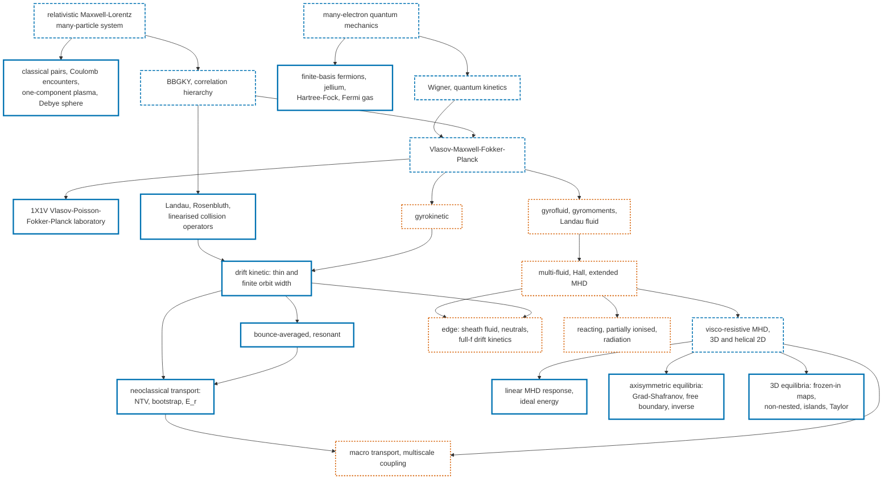

# Graph of plasma models

The models of MILCA and their reductions: an arrow runs from a parent model to a
model derived from it. The status of each node is that of its documentation page;
the derivations behind the arrows are planned in the [theory map](theory-map.md).

Solid blue: running with documented evidence; dashed blue: partly running;
dotted orange: designed.

| Model | Status | Page |
|---|---|---|
| relativistic many-particle system | partly running | [microscopic many-body](microscopic-many-body.md) |
| classical pairs, Coulomb encounters | running | [classical pair](classical-pair.md), [Coulomb encounter](coulomb-encounter.md) |
| one-component plasma, Debye sphere | running | [OCP](ocp-microscopic.md), [Debye sphere](debye-sphere.md) |
| BBGKY, correlation hierarchy | partly running | [correlation hierarchy](correlation-hierarchy.md) |
| finite-basis fermions, jellium, Hartree-Fock, Fermi gas | running | [quantum Fock](quantum-fock.md), [jellium](jellium-cell.md), [mean field](mean-field-cell.md), [Fermi gas](fermi-gas.md) |
| Wigner, quantum kinetics | partly running | [screening and Wigner](screening-wigner.md), [quantum plasma](quantum-plasma.md) |
| Vlasov-Maxwell-Fokker-Planck | partly running (1X1V) | [first example](first-example.md), [steady laboratory](steady-laboratory.md) |
| collision operators | running | [collisions](collisions.md) |
| gyrokinetic | designed | [model family](model-family.md) |
| drift kinetic, bounce-averaged, neoclassical | running | [drift kinetics](drift-kinetics.md), [extensions](drift-kinetics-extensions.md) |
| gyrofluid, gyromoments, Landau fluid | designed | [moment models](moment-models.md) |
| multi-fluid, Hall, extended MHD | designed | [model family](model-family.md) |
| visco-resistive MHD | partly running | [nonlinear resistive MHD](nonlinear-resistive-mhd.md), [section](vrmhd-section.md) |
| linear MHD response, ideal energy | running | [linear response](mhd-linear-response.md), [ideal energy](ideal-xi.md) |
| axisymmetric equilibria | running | [Grad-Shafranov](grad-shafranov.md), [free boundary](gs-free-boundary.md), [inverse](gs-inverse.md) |
| 3D equilibria | running | [ideal maps](ideal-map-3d.md), [non-nested](equilibrium-nonnested.md), [Taylor](equilibrium-beltrami.md) |
| edge | designed | [edge physics](edge-physics.md) |
| reacting plasmas, radiation | designed | [reacting](reacting-partially-ionized.md), [radiation](radiation.md) |
| macro transport | designed | [transport and multiscale](transport-multiscale.md) |
